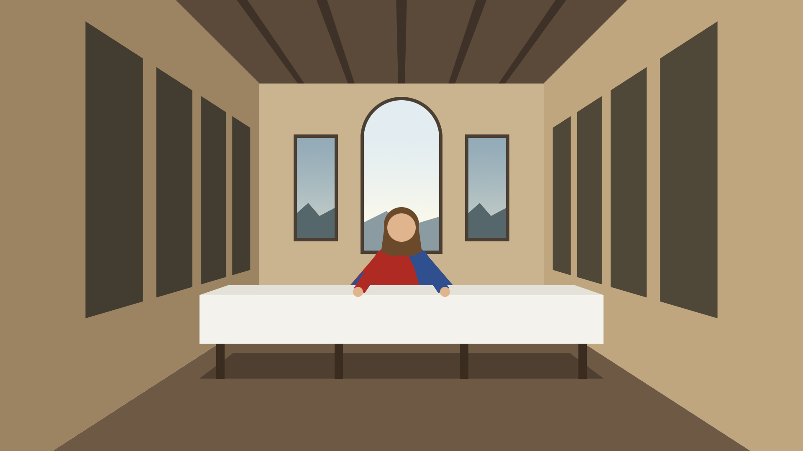

# Photoshop COM Bridge

Drive a running copy of Adobe Photoshop from the command line: write a drawing script in ExtendScript (`.jsx`), send it into Photoshop, and watch it draw.



*A simplified Last Supper, drawn shape by shape in Photoshop by [`last_supper.jsx`](last_supper.jsx) through the bridge.*

## What it is

| | |
|---|---|
| **App** | Adobe Photoshop **22.4.3** (Photoshop 2021) on **Windows** (tested on Windows 11) |
| **Way** | A **live, port-style bridge** using **Windows COM**, written in **PowerShell** |

"Live, port-style" means the bridge doesn't export files for Photoshop to import later, and it isn't a plugin that runs inside Photoshop. It connects from outside to the Photoshop that's already running, like plugging into a port, and sends the script over. The script runs right away in your open Photoshop session, and its result comes back to your terminal.

Under the hood, Photoshop registers a COM automation server called `Photoshop.Application` when it's installed. `ps_bridge.ps1` connects to it with `New-Object -ComObject Photoshop.Application` and calls `DoJavaScriptFile` with your `.jsx` file. If Photoshop isn't open yet, COM starts it.

## Files

| File | What it is |
|---|---|
| [`ps_bridge.ps1`](ps_bridge.ps1) | The bridge. Sends a `.jsx` file into Photoshop and prints what the script returns. |
| [`test_red_square.jsx`](test_red_square.jsx) | Smoke test. Creates a 1000×1000 document with a red square. |
| [`draw_lib.jsx`](draw_lib.jsx) | Drawing library: named layers, rectangles, polygons, circles and linear gradients, all in pixels. |
| [`test_draw_lib.jsx`](test_draw_lib.jsx) | Test for the library. Draws one of each shape and checks each layer lands on the right pixels. |
| [`last_supper.jsx`](last_supper.jsx) | The scene above, built from the library. |
| [`last_supper.png`](last_supper.png) | The rendered result. |

## How to run it

### What you need

- Windows 10 or 11.
- Adobe Photoshop installed (tested with 22.4.3). The installer registers the COM server, so there's nothing extra to set up.
- Windows PowerShell 5.1, which comes with Windows.

### Step by step

1. **Get the project.** Clone or download this repository and keep all the files together in one folder. The `.jsx` scripts load `draw_lib.jsx` from their own folder.

2. **Open PowerShell in the project folder.** In File Explorer, open the folder, type `powershell` in the address bar and press Enter. Or open PowerShell and run:
   ```powershell
   cd "C:\path\to\this\folder"
   ```

3. **Open Photoshop (optional).** If it isn't running, the bridge starts it, but the first launch can take a while. Make sure no dialog box is open in Photoshop (Preferences, a Save prompt and so on). Photoshop rejects scripts while a dialog is open.

4. **Run the smoke test:**
   ```powershell
   powershell -ExecutionPolicy Bypass -File .\ps_bridge.ps1 .\test_red_square.jsx
   ```
   `-ExecutionPolicy Bypass` lets this one command run the script even though Windows blocks unsigned scripts by default. It doesn't change any system setting.

   You should see:
   ```
   Connected to Photoshop 22.4.3
   Running: C:\path\to\this\folder\test_red_square.jsx
   OK: created 'Red Square Test' (1000x1000) with red square
   ```
   A new document called **Red Square Test** appears in Photoshop with a red square in the middle. The version number shows whichever Photoshop you have installed. If you see this, the bridge works.

5. **Run the drawing library test:**
   ```powershell
   powershell -ExecutionPolicy Bypass -File .\ps_bridge.ps1 .\test_draw_lib.jsx
   ```
   You can watch the shapes appear one at a time in a new **Draw Lib Test** document. The terminal prints a `PASS` or `FAIL` line per shape and ends with `ALL PASS`.

6. **Draw the Last Supper:**
   ```powershell
   powershell -ExecutionPolicy Bypass -File .\ps_bridge.ps1 .\last_supper.jsx
   ```
   To also save a PNG copy, give an output path as the script's argument:
   ```powershell
   powershell -ExecutionPolicy Bypass -File .\ps_bridge.ps1 .\last_supper.jsx -Arguments "C:\temp\last_supper.png"
   ```

### Writing your own scripts

```javascript
#target photoshop
#include "draw_lib.jsx"

var doc = app.documents.add(800, 600, 72, "My Drawing", NewDocumentMode.RGB, DocumentFill.WHITE);
Draw.newLayer(doc, "Sky");
Draw.linearGradient(doc, 0, 0, 0, 600, "#1e3c72", "#f7b733");
Draw.newLayer(doc, "Sun");
Draw.circle(doc, 400, 300, 80, [255, 200, 0]);
"done";   // the value of the last line is printed in your terminal
```

| Function | What it does |
|---|---|
| `Draw.newLayer(doc, name)` | Adds a named layer and makes it the one you're drawing on |
| `Draw.rect(doc, x, y, w, h, color)` | Filled rectangle from its top-left corner |
| `Draw.polygon(doc, [[x,y], ...], color)` | Filled polygon with smoothed edges, at least 3 points |
| `Draw.circle(doc, cx, cy, r, color)` | Filled circle with smoothed edges |
| `Draw.linearGradient(doc, x0, y0, x1, y1, from, to, [region])` | Gradient between two points. Fills the whole layer, or only `region` (`[x, y, w, h]`) if you give one |
| `Draw.boundsPx(layer)` | A layer's bounds in pixels, `[left, top, right, bottom]` |

Coordinates are always pixels, whatever the document's resolution or your ruler-unit setting. Colors can be `"#rrggbb"`, `[r, g, b]` or a Photoshop `SolidColor`. Each shape goes on the current layer, and the screen refreshes after every shape.

### Troubleshooting

- **"running scripts is disabled on this system"**: you left out `-ExecutionPolicy Bypass`. Use the commands exactly as shown above.
- **"Could not connect to Photoshop via COM"**: Photoshop isn't installed, or its COM registration is broken. Repairing or reinstalling Photoshop with the Creative Cloud app fixes the registration.
- **The command hangs or Photoshop says it's busy**: a dialog is open in Photoshop. Close it and run the command again.
- **"JSX execution failed: …"**: the script itself hit an error. The message comes from Photoshop, so it's in Photoshop's interface language. It names the line that failed.
- **Passing more than one argument:** with `powershell -File`, `-Arguments a,b` reaches the script as one string, `"a,b"`. Only one argument works this way. To pass several, run the bridge from inside a PowerShell session: `.\ps_bridge.ps1 .\script.jsx -Arguments a,b`.

## What I asked for, and what happened

This project was built with Claude Code. Below is each of my requests, quoted word for word, followed by what happened.

### 1. The bridge and the smoke test

> Build a PowerShell script called ps_bridge.ps1 that sends a .jsx file into my open Photoshop using COM. Then write a test .jsx that creates a 1000x1000 document with a red square, and run it through the bridge.

Claude checked that the `Photoshop.Application` COM server was registered. Photoshop wasn't running at the time. Claude wrote `ps_bridge.ps1` and `test_red_square.jsx`. Before running it, Claude changed the test so its result string is the script's last line, because a value returned from inside a `try` block isn't reliably passed back. COM started Photoshop and the test passed first time:

```
Connected to Photoshop 22.4.3
OK: created 'Red Square Test' (1000x1000) with red square
```

### 2. First commit

> Commit this with the message "Add PowerShell COM bridge and red square smoke test"

The commit failed because Git had no author name or email set up on this machine (`Author identity unknown`). Claude stopped and asked which identity to use instead of making one up.

> Set my git name to "Yifan Wang" and email to "crodie0315@gmail.com" globally, then retry the commit.

Claude set the global Git identity and the commit went through (`401efb7`).

### 3. The drawing library

> Create a reusable JSX drawing library called draw_lib.jsx for the bridge, with functions for new named layers, filled rectangles, filled polygons, circles, and linear gradients, all in pixel units. Each shape should appear on screen as it's drawn. Then write a short test script that uses the library to draw a few shapes, and run it through the bridge.

Claude wrote `draw_lib.jsx` and `test_draw_lib.jsx`. The test document is deliberately 150 ppi, to check that pixel coordinates don't depend on resolution. It draws a sky gradient, a rectangle, a triangle, a circle and a gradient limited to one area, then checks each layer's bounds. All five passed on the first run, accurate to the pixel. The check covers where each shape sits, not the gradient colors.

> Commit this with the message "Add JSX drawing library and test"

Committed (`76e4052`).

### 4. The Last Supper

> Draw a simplified version of Leonardo's The Last Supper in a new 1920x1080 document, without the apostles. Draw a room in one-point perspective with the vanishing point at the center, three windows on the back wall with the middle one largest and brightest, a long table with a white tablecloth, and Jesus in the center behind the table as a simple figure in a red robe and blue mantle. Use flat, simple shapes from the drawing library, each on its own named layer, and run it through the bridge.

Claude built the room as a simple 3D box and projected every corner onto the canvas, so all receding edges meet exactly at the center (960, 540). As in Leonardo's painting, that point falls on Jesus's head, which is framed by the bright arched middle window.

- **The bridge argument bug.** The first run failed before anything was drawn. Photoshop rejected the call with `非法参数 - 参数 2 - 不支持的 Variant 类型` ("illegal argument – argument 2 – unsupported Variant type"). The bridge had never been tested with `-Arguments` before. It turned the argument list into an array, but PowerShell left its own wrappers around each value, which COM can't accept. The fix copies each value into a plain array as an ordinary string. The rerun worked and drew 29 layers.
- **The neck.** Claude saved a PNG of the first draft and looked at it. The neck, a pale rectangle under the face, looked like a keyhole cut into the hair. Claude removed the neck layer, so the hair under the face now reads as a beard, like Leonardo's Jesus. Claude closed the first draft without saving and redrew the scene: 28 named layers, shown at the top of this README.

### 5. The image for this README

> Copy last_supper.png into this project folder so I can show it in my README.

Copied. Claude pointed out that the file was 6.2 MB, very large for flat shapes, because Photoshop had saved it with little or no compression.

> Commit this with the message "Add simplified Last Supper scene, fix bridge argument bug"

Committed (`53cbb5f`) with the scene, the bridge fix and the 6.2 MB PNG. Claude noted that the large image would stay in the history for good unless it was replaced before pushing.

> Compress the PNG and amend the commit

The first try failed. When the bridge runs through `powershell -File`, the two paths given as `-Arguments a,b` reached the script as one string, so Photoshop couldn't open the file. That's the multiple-argument limitation in Troubleshooting above. Claude changed the compress script to take a single argument. Photoshop then re-saved the image at maximum compression, from 6.2 MB down to 108 KB. The compression is lossless, and Claude checked the result before replacing the file. Claude also made `last_supper.jsx` save its PNGs at maximum compression from then on, and amended the commit (`6a68a6f`).

### 6. This README

> Write a README.md for this project. It must cover: which app (Photoshop 22.4.3 on Windows) and which way (a live, port-style bridge using Windows COM, written in PowerShell); how to run it, step by step, so a classmate with Photoshop on Windows can get it working from the README alone, including the smoke test; and what I asked for, quoting my exact requests word for word, and what happened each time, including the bridge argument bug you fixed and the neck you removed after checking the first draft. Show last_supper.png in the README. Then commit it.

This file.
